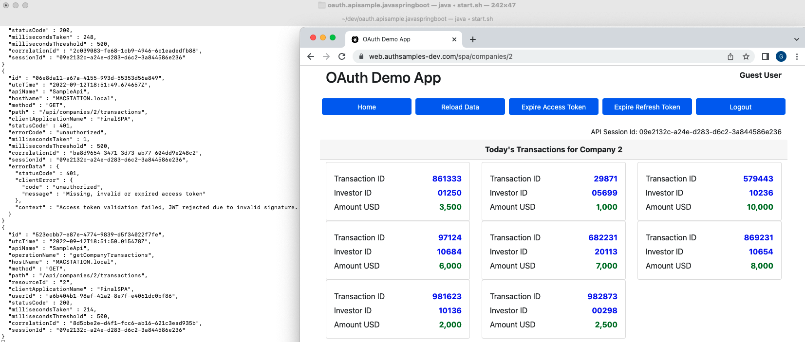
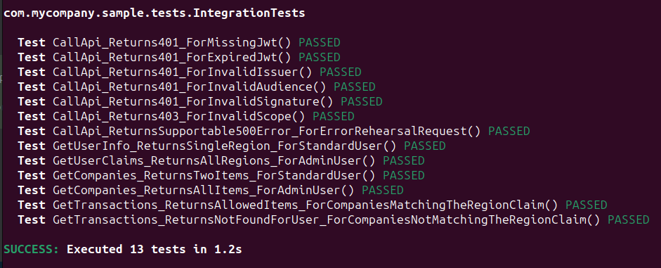
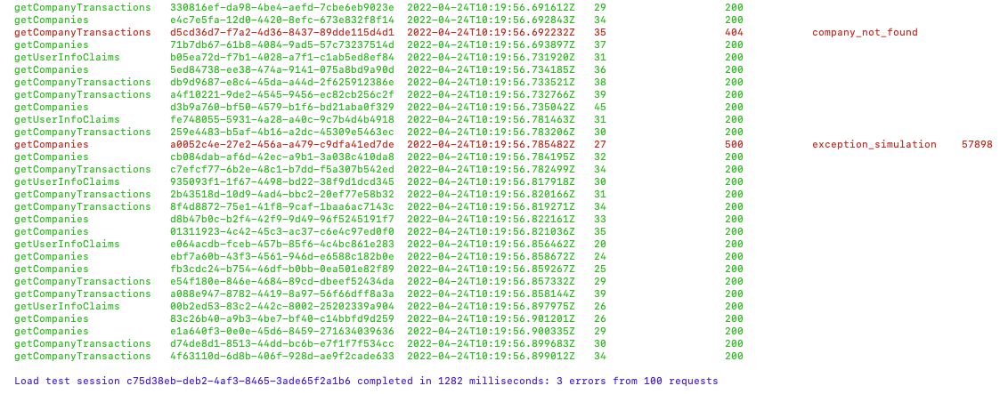
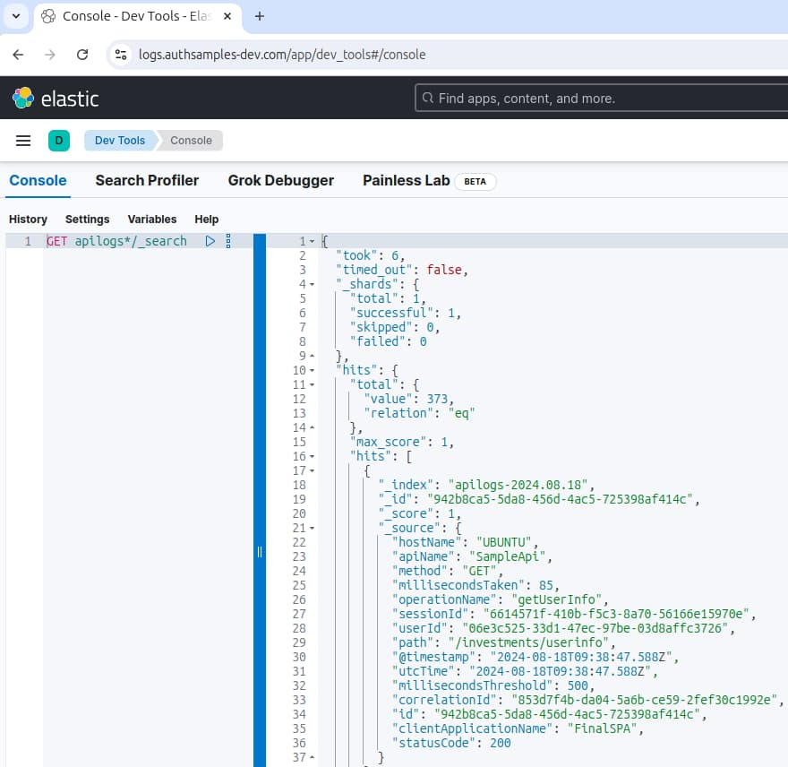

# Final Java Spring Boot API

[](https://app.codacy.com/gh/gary-archer/oauth.apisample.javaspringboot/dashboard?utm_source=gh&utm_medium=referral&utm_content=&utm_campaign=Badge_grade)

[](https://snyk.io/test/github/gary-archer/oauth.apisample.javaspringboot?targetFile=build.gradle)

The final OAuth secured Java API code sample, which returns mock `investments` data:

- The API takes finer control over claims-based authorization to enable security with good manageability.
- The API uses structured logging and log aggregation, for the best supportability.

### API Serves Frontend Clients

The API can run as part of an OAuth end-to-end setup, to serve my blog's UI code samples.\
Running the API in this manner forces it to be consumer-focused to its clients:



### API Security is Testable

The API's clients are UIs, which get user-level access tokens by running an OpenID Connect code flow.\
For productive test-driven development, the API instead mocks the authorization server:



A basic load test fires batches of concurrent requests at the API.\
This further verifies reliability and the correctness of API logs.



### API is Supportable

You can aggregate request logs and audit logs to Elasticsearch and run [Technical Support Queries](https://github.com/gary-archer/oauth.blog/tree/master/public/posts/api-technical-support-analysis.mdx).



## Local Development Quick Start

The API uses [Real World OAuth Development URLs](https://github.com/gary-archer/oauth.blog/blob/master/public/posts/developer-ssl-setup.mdx#real-world-oauth-development-urls) on a local computer.  
You must use admin permissions to configure infrastructure before you run the code.  

### Infrastructure Setup

Add DNS entries to your `/etc/hosts` file:

```bash
127.0.0.1 localhost api.authsamples-dev.com login.authsamples-dev.com
```

Make sure OpenSSL 3+ is installed, specify a secrets folder, then create development certificates:

```bash
export SECRETS_FOLDER="$HOME/secrets"
mkdir -p "$SECRETS_FOLDER"
./certs/create.sh
```

Ensure that a Java 25+ SDK is installed.  
Then, configure [HTTPS Trust](https://github.com/gary-archer/oauth.blog/blob/master/public/posts/developer-ssl-setup.mdx#trusting-a-root-certificate-in-java-apis) for the development root certificate authority:

```bash
sudo "$JAVA_HOME/bin/keytool" -import -alias authsamples.ca -cacerts -file ./certs/authsamples-dev.ca.crt -storepass changeit -noprompt
```

Then, grant Java access to listen on port 443, with a command of the following form:

```bash
sudo setcap 'cap_net_bind_service=+ep' "$JAVA_HOME/bin/java"
```

### Run the Code

Then run the API, which does not require admin permissions:

```bash
./start.sh
```

### Test the API

Stop the API, then re-run it with a test configuration:

```bash
./testsetup.sh
```

Then run integration tests and a load test:

```bash
./integration_tests.sh
./load_test.sh
```

## Further Details

* See the [API Journey - Server Side](https://github.com/gary-archer/oauth.blog/tree/master/public/posts/api-journey-server-side.mdx) for further information on the API's behaviour.
* See the [Overview Page](https://github.com/gary-archer/oauth.blog/tree/master/public/posts/java-spring-boot-api-overview.mdx) for further details on how to run the API.
* See the [OAuth Integration Page](https://github.com/gary-archer/oauth.blog/tree/master/public/posts/spring-boot-api-oauth-integration.mdx) for some implementation details.

## Programming Languages

* The API uses Java 25 and Spring Boot 4.

## Infrastructure

* Tomcat is the HTTP server that hosts the API endpoints.
* AWS Cognito is the API's default authorization server.
* The [jose4j](https://bitbucket.org/b_c/jose4j/wiki/Home) library manages in-memory JWT validation.
* The project includes API deployment resources for Docker and Kubernetes.
